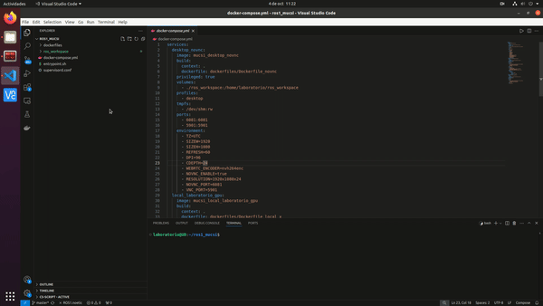
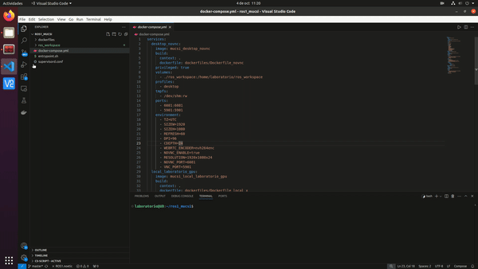

# Robótica y Automatización Inteligente - Entorno de desarrollo

Este repositorio proporciona un entorno de trabajo basado en ROS 2 Jazzy (Robot Operating System) para la asignatura de Robótica y Automatización Inteligente del Máster de Computación y Sistemas Inteligentes en la Universidad de Deusto. El entorno está empaquetado en contenedores Docker para asegurar la portabilidad y facilidad de uso.

## Herramientas Utilizadas

Antes de comenzar, asegúrate de tener instaladas las siguientes herramientas:

1. [Docker](https://www.docker.com/get-started): Docker es una plataforma para desarrollar, ejecutar y enviar aplicaciones dentro de contenedores. Puedes seguir [estas instrucciones](https://docs.docker.com/get-docker/) para instalar Docker en tu sistema.

2. [Visual Studio Code](https://code.visualstudio.com/): Utilizaremos VSCode para desarrollar dentro de los contenedores utilizando la extensión de [Remote - Containers](https://code.visualstudio.com/docs/remote/containers). Puedes instalar VSCode desde [aquí](https://code.visualstudio.com/download).

3. [Extensión Remote - Containers de VSCode](https://marketplace.visualstudio.com/items?itemName=ms-vscode-remote.remote-containers): Permite conectar VSCode a entornos de desarrollo que se ejecutan en contenedores Docker. Puedes instalarla desde el [marketplace de VSCode](https://marketplace.visualstudio.com/items?itemName=ms-vscode-remote.remote-containers).

4. [Git](https://git-scm.com/): Git es un sistema de control de versiones que utilizaremos para clonar este repositorio y gestionar versiones de código. Sigue [estas instrucciones](https://git-scm.com/book/en/v2/Getting-Started-Installing-Git) para instalar Git en tu sistema.


Opcionalmente, si trabajas en Linux, tienes una tarjeta gráfica NVIDIA y tu distribución utiliza el sistema de ventanas basado en X, puedes conseguir aceleración por GPU instalando:

-  [NVIDIA Container Toolkit](https://docs.nvidia.com/datacenter/cloud-native/container-toolkit/install-guide.html): Si planeas utilizar GPU para tus aplicaciones, necesitarás el soporte de GPU en Docker. Sigue la [guía de instalación de NVIDIA](https://docs.nvidia.com/datacenter/cloud-native/container-toolkit/install-guide.html) para habilitar esta funcionalidad.

## Requisitos del Sistema

- **Linux/macOS/Windows**: Docker y VSCode son compatible con todas estas plataformas, aunque algunas características pueden variar.
- **GPU** (opcional): Para aprovechar la aceleración de hardware, asegúrate de tener una GPU NVIDIA compatible y los drivers instalados.

## Contenedores Disponibles

Este repositorio incluye los siguientes contenedores:

1. **desktop** (por defecto): escritorio accesible desde el navegador (noVNC) con ROS 2 instalado. Funciona en cualquier sistema operativo (Windows, macOS, Linux) y arquitectura (x86, ARM, Apple Silicon); sólo requiere Docker.
2. **local_gpu** (perfil opcional): entorno local con soporte para GPU NVIDIA, sólo Linux con X11, para los PCs del laboratorio.
3. **local** (perfil opcional): igual que el anterior pero sin GPU.

Los contenedores 2 y 3 están desarrollados para ser utilizados en los PCs del laboratorio de robótica. Sólo se pueden utilizar si se cumplen los siguientes requisitos:
- El sistema operativo host es Linux (o WSL).
- El sistema operativo host utiliza el sistema de ventanas X.
- (versión GPU) El sistema tiene una gráfica NVIDIA con el nvidia-container-toolkit y sus drivers instalados.

Para el uso personal fuera del laboratorio se recomienda utilizar el contenedor **desktop**.
## Inicio rápido con los scripts (recomendado)

El repositorio incluye un script que hace todo lo necesario en cualquier sistema operativo. Lo único que se necesita es Git y Docker.

| Sistema | Script |
|---|---|
| Windows | `lab.bat` (desde PowerShell o CMD) |
| Linux / macOS / WSL | `./lab.sh` |

Los ejemplos usan `lab.sh`; en Windows sustituir por `lab.bat` (`.\lab.bat`).

1. **Instalar Docker** (si no está instalado): `./lab.sh instalar-docker`. En Windows usa `winget` para instalar Docker Desktop (requiere WSL 2; puede pedir reiniciar). En macOS usa Homebrew y, si no lo tienes, indica la descarga manual. En Linux usa el script oficial de Docker y `sudo`. Después hay que abrir Docker Desktop una vez (Windows y macOS) o volver a iniciar sesión (Linux).
2. **Clonar el repositorio**: `git clone https://github.com/ignacioDeusto/ros2_mucsi.git` y entrar en la carpeta.
3. **Iniciar el entorno**: `./lab.sh iniciar`. La primera vez construye la imagen (puede tardar varios minutos y, en ARM, bastante más), compila el espacio de trabajo y abre el escritorio en el navegador (`http://localhost:6081`, contraseña `laboratorio`).
4. **Lanzar una simulación**: `./lab.sh sim 203` (203, 204, 205 o 206). En el escritorio se abrirá RViz con el robot y MoveIt. Detener con `Ctrl+C`.
5. **Robot real**: `./lab.sh robot 203` (requiere estar en la red del laboratorio).
6. **Otros comandos**: `./lab.sh terminal` (terminal dentro del contenedor), `./lab.sh compilar` (recompilar tras modificar paquetes), `./lab.sh parar` (parar el contenedor sin perder su contenido) y `./lab.sh ayuda`.

En los PCs del laboratorio (Linux con X11) se puede usar el entorno local en lugar del navegador: `./lab.sh iniciar --lab` o `./lab.sh iniciar --lab-gpu` (con GPU NVIDIA).

### Problemas frecuentes

- *"Docker no está en ejecución"*: abre Docker Desktop y espera a que indique que está listo.
- *Permisos al compilar en Linux*: el usuario del contenedor tiene uid 1000; si tu usuario es otro, ejecuta `chmod -R a+rwX ros_workspace`.
- *Linux: "permission denied" con docker*: añade tu usuario al grupo `docker` y reinicia la sesión (`sudo usermod -aG docker $USER`).
- *Windows: scripts bloqueados*: usa `lab.bat`, que ejecuta PowerShell sin cambiar la política del sistema.
- *`lab.sh` no es ejecutable*: ejecuta `bash lab.sh iniciar` o `chmod +x lab.sh`.
- *El equipo o el contenedor se bloquea (código 137 = falta de memoria)*: el contenedor está limitado a 8 GB y 4 CPUs por defecto. Se puede cambiar con las variables `LAB_MEM` y `LAB_CPUS` (por ejemplo `LAB_MEM=6g LAB_CPUS=2 ./lab.sh iniciar`; en PowerShell `$env:LAB_MEM="6g"`). En Windows, limita además WSL 2 creando `%UserProfile%\.wslconfig` con `[wsl2]`, `memory=10GB`, `processors=6` y `swap=4GB`, y ejecuta `wsl --shutdown`. En Docker Desktop (macOS) ajusta Settings > Resources.
- *Pantalla en blanco en el navegador*: espera unos segundos y recarga; el escritorio tarda en arrancar.

Las secciones siguientes describen el procedimiento manual equivalente.

## Instalación

### 1. Clonar este repositorio

Clona este repositorio en tu máquina local:

```bash
git clone https://github.com/ignacioDeusto/ros2_mucsi.git
```
```bash
cd ros2_mucsi
```

### 2. Construir la imagen de los contenedores
Por defecto se construye el contenedor `desktop`. Los perfiles opcionales `local` y `local_gpu` sólo se usan en el laboratorio.

Una vez elegido el contenedor ejecutar:
```bash
docker compose build
```
En ARM (Apple Silicon...) la primera construcción tarda más porque `ur_rtde` se compila. Para los perfiles del laboratorio: `docker compose --profile local_gpu up` (o `--profile local`).

Cuando acabe el proceso ya se dispondrá de la imagen construida en el sistema.
### 3. Lanzar el contenedor
Una vez construida la imagen es posible crear contenedores a partir de ella. En este caso los contenedores están diseñados para utilizarlos como entornos de desarrollo. Se recomienda crear y utilizar un solo contenedor. Para esto ejecutar:
```bash
docker compose up
```
Una vez lanzado, la terminal se mantendrá ejecutando el contenedor hasta que se pare. Para pararlo basta con enviar una señal de terminación `ctrl`+`c`.

Es posible y recomendable gestionar el lanzamiento y parada de los contenedores desde la extensión remote de VSCode. Para gestionar la parada y lanzamiento de los contenedores ya creados desde VSCode:
<p align="center">
    
</p>

### 4. Acceso al contenedor
Es posible acceder al contenedor creado de varias maneras:
- Si el contenedor utilizado es el `desktop`, desde cualquier navegador se puede acceder a él en [esta dirección](http://localhost:6081). **La contraseña es laboratorio**. En esta dirección se sirve un escritorio funcional completo.
- Para todos los contenedores se recomienda asociar una instancia de VSCode al contenedor utilizando la extension "remote explorer". Esto permite desarrollar en VSCode como si se trabajara en local, pero ejecutando todo en el contenedor.

Incluso si se utiliza el contenedor `desktop` se recomienda desarrollar y lanzar todo desde VSCode y utilizar el escritorio para ver la salida gráfica del sistema. Para conectarse al contenedor desde VSCode:
<p align="center">
    
</p>

### 5. Primeros pasos en ROS 2
Dentro de los contenedores se incluye un espacio de trabajo de ROS 2 con todos los elementos necesarios para poder trabajar con los robots del laboratorio.

Antes de poder utilizarlos es necesario construir el espacio de trabajo base. Para construir el espacio de trabajo:

1. Conectarse al contenedor desde una instancia de VSCode.
2. Abrir una nueva terminal en VSCode.
3. Navegar hasta el directorio base del espacio de trabajo:
```bash
cd /home/laboratorio/ros_workspace
```
4. Actualizar la lista de paquetes disponibles del sistema:
```bash
sudo apt update
```
5. Actualizar el gestor de paquetes de ROS:
```bash
rosdep update
```
6. Instalar todas las dependencias del espacio de trabajo base:
```bash
rosdep install --from-paths src --ignore-src -r -y
```
7. Construir el espacio de trabajo:
```bash
colcon build --symlink-install
```
Si todo se ha ejecutado de manera correcta, el espacio de trabajo ya está en condiciones de uso.

Antes de poder utilizar el espacio de trabajo hay que activarlo en la terminal:
```bash
source /home/laboratorio/ros_workspace/install/setup.bash
```
>**IMPORTANTE:**
**<u>La activación del espacio de trabajo se debe realizar en cada nueva terminal abierta en la que se quiera utilizar algo relacionado con este.</u>**

Si siempre se va a utilizar el mismo espacio de trabajo, es posible incluir la activación en el fichero `/home/laboratorio/.bashrc` que se ejecuta cada vez que se abre una nueva terminal. Si se incluye, no hace falta volver a activar el espacio de trabajo.

Para comprobar que el sistema funciona correctamente, ejecutar en la terminal donde se ha activado el espacio de trabajo:
```bash
ros2 launch launcher_robots_lab_robotica sim_203.launch.py
```
Esto debería ejecutar todos los nodos necesarios para poder controlar uno de los Universal Robots en simulación. Debería aparecer una interfaz gráfica en la que se muestra el robot y si se selecciona el grupo de planificación `robot`, debería permitir moverlo a diferentes posiciones, planificar y ejecutar trayectorias.

### Dos robots a la vez

Para trabajar con dos robots en la misma escena (un único `move_group`, un único RViz) se usan los xacros combinados:
```bash
ros2 launch launcher_robots_lab_robotica sim_203_204.launch.py   # o ./lab.sh sim 203-204
ros2 launch launcher_robots_lab_robotica sim_205_206.launch.py   # o ./lab.sh sim 205-206
```
Los nombres llevan el id del robot: grupos de planificación `robot_203`, `gripper_203`, controladores `/robot_203_scaled_joint_trajectory_controller/follow_joint_trajectory`, pinza `/robot_203/rg2_action_server`, y articulaciones/enlaces con prefijo (`203_shoulder_pan_joint`). Existen además grupos conjuntos que planifican y ejecutan los dos robots a la vez: `robots_203_204` (los dos brazos) y `grippers_203_204` (las dos pinzas), con los estados `zeros`, `home`, `open` y `closed`. Son grupos de articulaciones (sin cinemática inversa), así que se usan con objetivos en el espacio articular; en objetivos de 12 articulaciones conviene una tolerancia de ~0.01 rad (con 0.001 OMPL puede no encontrar solución). En `ControlRobot` basta con cambiar `group_name` a `"robots_203_204"`. Para las parejas 205+206 los nombres son análogos.

Existen también `robot_203_204.launch.py` y `robot_205_206.launch.py` para los robots reales, **sin probar**: no incluyen el control del dashboard, por lo que hay que liberar los frenos y arrancar el programa *External Control* desde la consola de cada robot.

El control de los robots se realizará utilizando el framework MoveIt 2 que abstrae los topics de ROS y proporciona funcionalidades para planificar y ejecutar trayectorias además de gestionar la escena de planificación. Se puede encontrar documentación extensa de su API de Python [aquí](https://moveit.picknik.ai/main/index.html). Los ejemplos de la carpeta `ejemplos/` usan rclpy y las acciones/servicios de `move_group`.
### Aspectos a considerar en el desarrollo

- Todo lo que se instale, ejecute y modifique a partir de la creación se pierde si el contenedor se elimina. Si el contenedor se para en vez de eliminarlo, mantendrán todas las modificaciones hechas cuando se vuelva a lanzar.
- Los contenedores comparten un directorio con el host. Todo cambio que se haga en este desde el contenedor se verá reflejado en el host y viceversa. Este directorio en el contenedor es: `/home/laboratorio/ros_workspace` y en el host depende de donde y cómo se haya creado el contenedor.
- No confundir el host con el contenedor (estarán en instancias separadas de VSCode).
- No lanzar docker compose down salvo que se quiera eliminar el contenedor (se pierde todo lo instalado fuera de `ros_workspace`). Para pararlo sin eliminarlo, usar `docker compose stop`.

### Diferencias respecto a la versión ROS 1 (25_26)

- ROS 2 Jazzy sobre Ubuntu 24.04; compilación con `colcon`.
- Se usan el driver oficial de UR (`ur_robot_driver`) y MoveIt 2 instalados desde apt; ya no se incluyen paquetes vendorizados.
- El sistema de referencia raíz del robot es `world` (antes `base_link`).
- Robots reales: `ros2 launch launcher_robots_lab_robotica robot_203.launch.py` (203-206). Simulación: `sim_203.launch.py`. Parejas: `sim_203_204`, `sim_205_206` (ver "Dos robots a la vez").
- La pinza RG2 se maneja con el paquete `rg2_driver` (`simulate:=true` en simulación). Requiere `ur_rtde` (`pip`, ya incluido en la imagen). En la pinza la articulación `joint0` se ha reorientado respecto a ROS 1 porque `tool0` de ROS 2 está girado respecto al de ROS 1.
- Los ejemplos usan `rclpy` + `move_group` (acciones `move_action`/`execute_trajectory`) en lugar de `moveit_commander`. `ejemplos/control_robot.py` acepta un id de robot opcional (`ControlRobot("203")`) para las escenas dobles.
- Los nombres de nodos/controladores no pueden empezar por un número, por eso en las escenas dobles son `robot_<id>_...`, mientras que articulaciones y enlaces llevan el prefijo `<id>_`.

## Arquitectura

- `dockerfiles/`: imagen basada en ROS 2 Jazzy + escritorio XFCE con noVNC (puerto 6081, contraseña `laboratorio`), multiarquitectura (x86_64/arm64). `docker-compose.yml` define los perfiles y los límites de recursos (`LAB_MEM`, `LAB_CPUS`).
- `ros_workspace/src/launcher_robots_lab_robotica`: xacros (UR3e + RG2, con `ros2_control`), calibraciones por robot, configuración de MoveIt 2 y los lanzadores. `lanzador.py` genera el lanzamiento de un robot; `lanzador_doble.py` genera el de una pareja (SRDF, controladores y MoveIt combinados en una carpeta temporal).
- `ros_workspace/src/rg2_driver`: servidor de acción `GripperCommand` de la pinza RG2 (con `prefix` y `namespace` para las escenas dobles).
- `lab.sh` / `lab.ps1` / `lab.bat`: scripts multiplataforma (instalar Docker, iniciar, `sim`, `robot`, `terminal`, `compilar`, parar).

## Estado de verificación

Probado (simulación, Docker Desktop en Windows con WSL2, x86_64): construcción de la imagen y del workspace, `sim_203`..`sim_206`, `sim_203_204`, `sim_205_206` (incluidos los grupos conjuntos en 203+204), ejemplos de MoveIt, escritorio noVNC.

**Sin probar**: robots reales (individuales y por parejas), cámara USB, pinza real, compilación completa en arm64/Apple Silicon, perfiles `local`/`local_gpu`, `.devcontainer`, `instalar-docker` en todas las plataformas. Desde Windows/Mac no están publicados los puertos del driver (50030-50062) para robots reales. En ARM, `ur_rtde` se compila desde código fuente.
